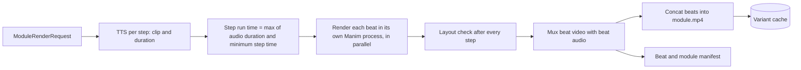

# FourierLearn build plan

This plan turns the project report (_FourierLearn: Interactive Mathematics Video Generation for
O-Level Students_, FYP report, 10 Oct 2026) into an ordered list of work for a team of three. It
covers the whole project, from the render engine to the user study. Section numbers such as "§5.4.4"
refer to the report.

The order follows the report's own development method (§6.2.4): _first a working narrated
animation and browser player, then automated planning, interactive controls and learner
modelling._ The first thing we build is the **render engine**. It takes primitive code with its
parameters and the narration, renders each beat with Manim, fits the animation to the audio, and
joins the beats into a narrated module.

After the engine, **Phase 2 builds the complete frontend** against a stub API that already has
the final endpoints. The backend phases that follow then fill in the real behaviour behind
screens that already work, one endpoint at a time.

---

## 1. What the report commits us to

### Five components plus a scheduler (§4.3.5, Fig. 5.1, Fig. 6.1)

| Component                  | Job                                                                                                   | Package under `backend/app/`    |
| -------------------------- | ----------------------------------------------------------------------------------------------------- | ------------------------------- |
| Prompt Interpreter         | Query → target concept (or out of scope) → lesson plan of scene plans (§5.2)                          | `prompt_interpreter/`           |
| Code Generator             | Scene plan segment → **parameters only** for a validated primitive, checked with SymPy (§5.3.3)       | `code_generator/`               |
| Visual primitive library   | Hand-written, offline-validated Manim CE components with schema, predicates, layout, difficulty hooks | `primitives/`                   |
| Audio Pipeline             | Narration script per step, slot filling, checks, TTS at 3 levels (§5.4)                               | `audio_pipeline/`               |
| **Render engine** (new)    | Beat render → audio/video fit → layout check → mux → stitch → manifest → cache (§5.3.4, §5.4.4)       | `renderer/` (new, no DB access) |
| Render workers             | Run render jobs from the queue, stateless, scalable (§4.4.4)                                          | `workers/`                      |
| Scheduler                  | Priority queue, prefetching, level selection per module, Algorithm 1 (§5.5)                           | `scheduler/`                    |
| Learner State Module       | BKT, signal evidence, difficulty policy (§5.7)                                                        | `learner_state/`                |
| Interactive Playback Layer | Next.js player, concept chips, "I'm Lost", branch points, checks, logging (§5.6)                      | `frontend/`                     |

### Numbers we must hit (§4.4)

- First module starts playing **≤ 90 s** after the query is submitted.
- Next module is ready **before the current one ends** (no wait between modules).
- "I'm Lost" plays the simpler variant **≤ 90 s** after the press, with a progress indicator.
- Chips, checks and branch choices respond in **≤ 3 s**.
- **≥ 90 %** of module renders succeed without manual help (retries count).
- Level 1 is up to 90 s long, Level 2 about 60 s, and Level 3 under 60 s (Table 5.3).
- A lesson starts in **≤ 2 steps** from home, and "I'm Lost" is a single tap that stays visible.
- Salted password hashes, HTTPS, signals used only for adaptation, and stateless render workers.

### Three rules that shape every task (§5.1)

1. **Correct by construction.** Models choose primitives and write parameter values. They never
   write Manim code. Every number on screen is computed by SymPy.
2. **Generation stays off the critical path.** Module N+1 renders while module N plays. A beat is
   the unit of rendering, so playback can start when the first beat is ready.
3. **Adapt between and within modules.** The level is chosen per module, and "I'm Lost" swaps the
   variant from the current beat onward. All variants share the same beats in the same order.

> Terminology: the report calls the parts of a module **segments** in Chapter 5 and **beats** in
> Chapter 6. They are the same thing. This plan and the code use **beat**.

---

## 2. Team lanes

Each of the three people owns one lane for the whole project. That way each of you owns a part of
the code end to end, and the lanes only meet at the contracts in §3.

| Lane                         | Owns                                                                                                                                                                              |
| ---------------------------- | --------------------------------------------------------------------------------------------------------------------------------------------------------------------------------- |
| **A — Engine & pipeline**    | Render engine, render workers and job queue, variant cache, media serving, SSE, Code Generator, scheduler (Algorithm 1), "I'm Lost" backend, performance and reliability          |
| **B — Content & models**     | Primitive library and its validation harness, scene-plan schema, concept taxonomy, Prompt Interpreter and lesson planner, BKT and difficulty policy, evaluation harness, analysis |
| **C — Product & learner UX** | TTS adapter, DB schema and migrations, narration generation, auth, every frontend screen (player, chips, I'm Lost, checks, branches, diagnostic, progress), admin, study mode     |

Content authoring (the taxonomy, glossary definitions, check items and pre/post tests) is the
longest single task and does not need code. **All three** of you add to it every sprint, and B
coordinates it.

Choose who takes which lane. A suits whoever already owns the repo tooling.

> **Phase 2 is the exception.** B and C both work on the frontend, and A writes the API and its
> stub. See [docs/frontend.md §3](frontend.md#3-who-does-what).

---

## 3. Phase 0 — Contracts (week 1, all three, together)

> **Status: done** (merged in PR #6). Two contract changes came out of Phase 1; see the end of
> [docs/contracts.md](contracts.md).

Agree on these before writing feature code. Then the three lanes can work in parallel and fit
together later. They live in `backend/app/contracts/` as Pydantic models, and
**[docs/contracts.md](contracts.md)** explains each one with its report section. After week 1, a
change to them needs a PR that all three review.

1. **`Level`**: `IntEnum` with `SUPPORTED = 1`, `STANDARD = 2`, `CONCISE = 3`. `Level.label` gives
   the "Level 1" text that MODULE.difficulty_level stores (Table 4.8).
2. **`Primitive` interface** (§5.3.1): the four elements of a primitive (parameter schema,
   validation predicates, layout contract, difficulty hooks), plus the validated default
   parameters, the SymPy-computed on-screen values, `animate` (plays the steps and yields the
   visible objects after each one). (Phase 0 also had `add_final_state`; Phase 1 replaced it by
   replaying earlier beats, see docs/contracts.md.)
3. **`ScenePlan`** (Table 5.1): `module_id`, `concept_id`, `segments[]` with `primitive_id`,
   `content` (expressions), `narration_intent` and `glossary_terms`, then `check_items` and
   `branch_options`. A plan has **no level**, because one plan renders at all three levels.
4. **`ModuleRenderRequest`**: `module_id`, `level`, `voice`, `library_version`, and `beats[]`. Each
   beat has `primitive_id`, validated `params`, `narration: list[str]` (one passage per step),
   `glossary_terms` and `concept_ids`. This is the engine's input.
5. **`ModuleManifest`** (§5.4.4): for each beat its video, duration, step start and end times with
   the passage text, chip intervals and concept ids. The player, the interaction log and the
   "I'm Lost" logic all read it.
6. **`variant_cache_key()`**: the sha256 of the canonical JSON of the primitive ids, parameter
   sets, level, narration voice and primitive library version (§4.2.3, §5.3.4).
7. **`InteractionEvent`**: the six event types of Table 4.8 (rewind, speed change, pause, chip view,
   I'm Lost, branch choice), each with its module, beat, position and timestamp. A speed change
   carries the rate before and after, and a pause carries its duration.
8. **API sketch**: REST over HTTPS plus Server-Sent Events for progress (§6.4.12).

Done when: the models are merged with unit tests, and one example `ModuleRenderRequest` JSON is
committed under `backend/examples/`.

---

## 4. Phase 1 — Render engine (weeks 1–4) ← **build first**

**Goal:** given primitive code, parameters and narration text, produce a narrated module at any
level, with no LLM, database or frontend involved.

> **Status: done, except the hosted-voice bake-off.** Everything below is built and tested; see
> "What Phase 1 delivered" at the end of this section. The narration voice is Kokoro-82M, a free,
> local neural voice (Apache 2.0) that replaced the robotic espeak-ng. Comparing hosted voices needs API keys and a budget decision,
> so lane C still owes that comparison; a hosted voice plugs in as one more `TTSProvider`.

### How the engine works (from §5.3.4 and §5.4.4)

1. **Audio first.** Synthesise each step's passage at the level's speech rate. Measure each clip's
   duration with ffprobe.
2. **Fit the animation to the audio.** Each step's
   `run_time = max(audio_duration, step.min_run_time(level))`. At Level 1, add a short pause after
   each step.
3. **One Manim scene per beat**, built from a fixed scene template:
   - Replay the previous beats without rendering them, which adds their final state without
     animation.
   - Run the steps with the computed run times.
   - Record the actual scene time at each step boundary for the manifest.
4. **Layout check** at the end of every step. Compute the bounding box of every visible mobject and
   reject the beat if a box leaves the frame, or if two boxes overlap when the layout contract does
   not allow it. The `LayoutViolation` error names the objects involved, so the parameter model can
   retry (§5.3.4).
5. **Beat audio track**: `concat(clip_i + silence(run_time_i − audio_i))`, in step order. Mux it
   with the beat video using ffmpeg: H.264 yuv420p, AAC, `+faststart`, and the same resolution and
   fps for every beat.
6. **Parallel beats.** Use a `ProcessPoolExecutor`, because Manim is not thread-safe. Each beat
   gets its own media directory, and the pool size is capped by memory (§6.4.7). Fire a callback
   **as soon as each beat is ready**, so playback can start on beat 0 (§5.5).
7. **Stitch** with the ffmpeg concat demuxer and `-c copy`. This is possible because all beats
   share encode settings. The player streams beats individually. The stitched `module.mp4` is for
   the static study condition and for review.
8. **Manifest and cache.** Write `manifest.json`, then store everything under
   `media/variants/<cache_key>/`.

### Practical points

- Make render quality a setting (for example 480p30 or 720p30). Pick the value from a benchmark,
  because a module must render in under one module's playback time (§5.5, §4.10).
- LaTeX compilation dominates the first render. Point every worker at one shared, persistent
  Manim `tex_dir` and pre-warm common expressions.
- Use a **`TTSProvider` adapter** with `synthesize(text, voice, rate) -> Clip(path, duration)`:
  - `FakeTTS` writes silent audio whose length comes from the word count and the level's words per
    minute. CI and the engine tests use it, so they need no network or API key.
  - One real provider, chosen in a short bake-off on clarity, cost, latency and speed control. If
    the provider has no speed setting, change the rate with ffmpeg `atempo`.
  - `manim-voiceover` does a similar job and is useful to read, but we keep TTS outside the render
    process so that audio can be cached and timed before rendering.
- Add a developer CLI. `npm run render -- backend/examples/gradient_of_line.L2.render.json` should
  print the module path and timings.
- Tests:
  - Unit tests for the timing math, audio assembly, manifest, cache key and ffmpeg command
    building. These run in normal CI with no LaTeX or ffmpeg.
  - One real render test marked `@pytest.mark.render`. It runs in the Docker full-check workflow,
    which already has Manim working.

### Lane tasks

| Lane  | Tasks                                                                                                                                                                                                                                                                                                                                         |
| ----- | --------------------------------------------------------------------------------------------------------------------------------------------------------------------------------------------------------------------------------------------------------------------------------------------------------------------------------------------- |
| **A** | `app/renderer/`: scene template and runner, timing, process pool with per-beat callback, layout check, audio track assembly, mux, stitch, manifest, cache key and storage, CLI, render-time benchmark (`docs/benchmarks.md`)                                                                                                                  |
| **B** | `Primitive` base class (pair with A in week 1). First primitives at all three levels: **FunctionGraph**, **EquationTransform**, **GradientTriangle**, each with SymPy predicates, `computed_values` and layout region. Skeleton of the parameter-grid validation harness                                                                      |
| **C** | `audio_pipeline/tts.py`: adapter, `FakeTTS`, provider bake-off, real provider, rates for the 3 levels, duration measurement. First SQLAlchemy models and Alembic migration (Table 4.8). A dev page in Next.js (`/dev/modules`) that plays a rendered module and shows its manifest: captions, chips per beat and a progress bar split by beat |

### Done when (milestone **M0: engine demo**)

- [x] One hand-written request (gradient of a line, 3 beats) renders at **L1, L2 and L3**. L2 is
      about 60 s, L1 is at most 90 s, L3 is under 60 s, and the narration is real.
- [x] Each step starts in the video within ±50 ms of its narration start. Check this from the
      manifest against ffprobe.
- [x] Beats render in parallel, the first-beat callback fires before the module finishes, and there
      is no visual jump at beat boundaries.
- [x] A deliberately overlapping request fails the layout check, and the error names the objects.
- [x] Rendering the same request a second time is a cache hit with no render.
- [x] Render time per beat and per module is recorded at each quality setting.

### What Phase 1 delivered

| Area          | Where                                   | Notes                                                                                                                                |
| ------------- | --------------------------------------- | ------------------------------------------------------------------------------------------------------------------------------------ |
| Render engine | `backend/app/renderer/`                 | `npm run render -- <request.json>`. Narration first, steps fitted to it, beats in parallel processes, layout check, mux, join, cache |
| Primitives    | `backend/app/primitives/`               | FunctionGraph, GradientTriangle, EquationTransform at three levels; safe SymPy parsing; [docs/primitives.md](primitives.md)          |
| Validation    | `npm run primitives:check`              | 6 parameter sets × 3 levels per primitive; review sheets with frames (§5.3.2)                                                        |
| Voice         | `backend/app/audio_pipeline/tts.py`     | Kokoro (local neural voice), espeak-ng and a silent fake for tests; speech rate per level                                            |
| Database      | `backend/app/db/models.py` + migration  | The nine tables of Table 4.8, checked against the data dictionary by a test                                                          |
| Dev viewer    | `frontend/src/app/dev/modules/page.tsx` | Plays a variant beat by beat with captions, chips and a progress bar split by beat                                                   |
| Measurements  | [docs/benchmarks.md](benchmarks.md)     | Render times per level and quality, and narration sync                                                                               |

The validation harness earned its keep: it found labels colliding at extreme coordinates, and
reviewing its frames found a fraction that SymPy's printer had rewritten (`(3/4)*(8/9)` shown as
`3 · 1/4 · 8 · 1/9`). Both are fixed.

---

## 5. Phase 2 — The complete frontend on a stub API (weeks 5–8)

> **Status: in progress. Lane A's part is done; the screens (lanes B and C) are next.**
>
> - Every endpoint of the API catalogue exists, with its final request and response shapes, and
>   is served by the stub. That covers auth, topics, glossary, diagnostic, lessons, playback,
>   checks, branches, "I'm Lost", the event stream, interaction events, progress and admin.
> - The example module is committed as fixture videos at all three levels.
> - `npm run api:types` generates the frontend's types, and CI checks that they match the backend.
> - Next.js forwards `/api` and `/media` to the backend, with the event stream checked through it.
> - The stub has 15 tests that go through the API.
>
> The README's "The stub API" section says how to use it.

**Goal (milestone M1):** every screen and interaction in the report works in the browser. That
covers:

- the landing page, auth and the diagnostic
- the home screen, the lesson player with chips, "I'm Lost", rewind and speed
- the checks and branch points between modules
- resume, history and progress
- the admin area

Behind the screens is a **stub** backend. Every endpoint exists at its final path with its final
request and response shapes, but the data comes from an in-memory store and real pre-rendered
example videos. Phases 3–7 replace the stub inside each endpoint with the real code; the frontend
does not change.

> **The full guide for this phase is [docs/frontend.md](frontend.md).** It covers the rules,
> every screen, the player's behaviour in detail, the API catalogue with request and response
> shapes, the stub's behaviour, the tools, the tests, the week-by-week split and the done-when
> checklist. Read it before starting.

Why the frontend comes now:

- **The API shapes get fixed early,** while changing them is cheap.
- **Two people work in parallel without waiting for the backend.**
- **Each backend phase has a working screen to test against,** and the player, the part students
  judge the project by, gets the most time to mature.

| Lane  | Tasks                                                                                                                                                                                                                                                                                                                                                                                                                                                                                                                                                                           |
| ----- | ------------------------------------------------------------------------------------------------------------------------------------------------------------------------------------------------------------------------------------------------------------------------------------------------------------------------------------------------------------------------------------------------------------------------------------------------------------------------------------------------------------------------------------------------------------------------------- |
| **A** | ✅ **API schemas** for every endpoint (Pydantic models in `backend/app/api/schemas/`, frontend.md §7) and the **stub service** (frontend.md §8): an in-memory store with seed data, the example module committed as fixture variants at all three levels, a timed SSE stream, "I'm Lost" substitution between the fixture levels, and test triggers for slow and failed modules. **`npm run api:types`** generates the frontend types from the OpenAPI schema, and CI fails when they are out of date. **Next.js rewrites** for `/api` and `/media`. From week 7, start Phase 3 |
| **B** | Design system and layout. Landing page and topics page. Register, login, logout and route guards. **Onboarding diagnostic** (Fig. 4.1). **Home** (Fig. 4.2) with the out-of-scope reply. Lesson history, **progress** (Fig. 4.6) and account. **Admin** (§4.2.2): overview, primitives, glossary, check questions, render jobs, students                                                                                                                                                                                                                                        |
| **C** | **Lesson player** (Fig. 4.3): two videos taking turns, segmented progress bar, rewind, speed, captions, fullscreen and keyboard. **Concept chips** with an overlay while the video keeps playing. **"I'm Lost"**: the substitution with a progress indicator, and the Level 1 replay. Generating and preparing screens. **Check** (Fig. 4.4) and **branch** (Fig. 4.5) with its timeout. Lesson summary, failed-module fallback, saving the position and resuming. **Event logger** and SSE hook. Static study mode                                                             |

### Done when (milestone **M1: frontend**)

- [ ] A new student registers, finishes the diagnostic, asks a question and watches a lesson to
      the end, with checks, a branch and an "I'm Lost" press, using only the UI.
- [ ] Every admin page works against the stub.
- [ ] The frontend calls the backend only through `src/lib/api/`, with generated types, and has
      no mock data of its own.
- [ ] The full checklist in [frontend.md §13](frontend.md#13-done-when-milestone-m1) is met.

Not code, but start now: **contact a partner school and apply for ethics approval** (§4.10 and
§5.9.4 need parent consent and student assent). Approval takes weeks, and the study cannot start
without it.

---

## 6. Phase 3 — Job queue, primitive library, first real module (weeks 9–12)

**Goal (milestone M2):** a **hand-written scene plan** goes through the real job queue and render
workers. It becomes a narrated module that plays in the Phase 2 player and starts at the first
beat. This is a good demo for the FYP-I evaluation.

> **Status: the backend is done.** M2 now needs only the Phase 2 player to play these lessons.
>
> **Lane B:**
>
> - **The primitive library:** all seven primitives of Table 5.2. The four new ones each have six
>   harness cases at three levels; all 126 renders pass, and their frames were reviewed.
> - **Beyond Table 5.2:** the library is growing to cover the whole O Level syllabus (4024) and
>   the calculus of 4037, as mapped in [primitive-coverage.md](primitive-coverage.md): 27
>   primitives so far (algebra and graphs, coordinate geometry and calculus done). Each passes the harness at all three levels.
> - **Plan checks:** the scene-plan reference check (`app/prompt_interpreter/plan_checks.py`).
> - **Content files:** the concept taxonomy with prerequisite edges, the glossary and the item bank,
>   as content files in `backend/content/`. The syllabus codes there are still placeholders.
>
> **Lane A:**
>
> - **The queue:** the render queue in Postgres, with priorities, three attempts, a lease so a
>   dead worker's job is taken over, and the variant cache consulted first.
> - **The worker:** `npm run worker`, also a Docker service.
> - **The dev endpoint:** `POST /api/dev/render`, which stores a hand-written lesson and queues its
>   renders. Its lessons play through the same endpoints as the stub's, including a live event
>   stream. The first beat is playable before the module finishes; a manifest is published after
>   every beat.
>
> **Lane C:**
>
> - **The database:** `POST /api/events` writes INTERACTION_EVENT rows, and topics and glossary come
>   from the database once `npm run db:seed` has loaded `backend/content/`.
>
> **Checks:**
>
> - Measured on 4 cores at 480p with Kokoro: the example lesson's first module was playable after
>   27 s, and the whole lesson was ready after 40 s.
> - The Docker CI job runs that same check.
> - The database tests run in CI against Postgres.
>
> Not in this phase: "I'm Lost" and branch insertion for these lessons (Phase 6), and the learner
> model updating scores from check answers (Phase 5). The answers are stored now.

| Lane  | Tasks                                                                                                                                                                                                                                                                                                                                                                                                                                                                                                                                                                                                                                          |
| ----- | ---------------------------------------------------------------------------------------------------------------------------------------------------------------------------------------------------------------------------------------------------------------------------------------------------------------------------------------------------------------------------------------------------------------------------------------------------------------------------------------------------------------------------------------------------------------------------------------------------------------------------------------------- |
| **A** | **Job queue in Postgres.** The report names no queue, and a Postgres table avoids running Redis (KISS, §6.2.3): a `render_job` table, `SELECT … FOR UPDATE SKIP LOCKED`, and priority, status and attempts columns. A `workers/` process run with `npm run worker`, stateless and scaled by running more copies. 3 retries, with failures logged (§6.4.6). Cache lookup before enqueueing. Media served with FastAPI `StaticFiles`. API: `POST /api/dev/render` (plan JSON → a lesson), and the real `GET /api/lessons/{id}/current-module` and `GET /api/lessons/{id}/events` (SSE: beat ready, module ready, failed) in place of their stubs |
| **B** | Finish the initial library (Table 5.2): **TangentSlide, SecantToTangent, TravelGraph, AreaUnderCurve**. **Offline validation harness**: render each primitive across a grid of parameter values at all levels, run the layout check, and produce a sheet for manual review (§5.3.2). Write a library version stamp into the cache key. Pydantic `ScenePlan` with the **schema check and reference check** (§5.2.3). Start the **concept taxonomy**: syllabus points, prerequisite edges and syllabus codes                                                                                                                                     |
| **C** | **First stubs replaced by the database:** `POST /api/events` writes INTERACTION_EVENT rows (with beat, position and payload, §13 gap 3); `GET /api/topics` and `GET /api/glossary/{term}` read the CONCEPT and GLOSSARY_TERM tables. An idempotent seed command, `npm run db:seed`, for the taxonomy and glossary. Fix what the player shows up against real renders and real render times                                                                                                                                                                                                                                                     |

---

## 7. Phase 4 — From a query to a generated lesson (weeks 13–18)

**Goal (milestone M3):** the student types _"explain the gradient of a curve"_ and gets an
automatically planned, parameterised, narrated lesson. Everything runs at one level for now.
First-module wait is measured against the 90 s target.

| Lane  | Tasks                                                                                                                                                                                                                                                                                                                                                                                                                                                                                                                                                                                                                                                                                                                                          |
| ----- | ---------------------------------------------------------------------------------------------------------------------------------------------------------------------------------------------------------------------------------------------------------------------------------------------------------------------------------------------------------------------------------------------------------------------------------------------------------------------------------------------------------------------------------------------------------------------------------------------------------------------------------------------------------------------------------------------------------------------------------------------- |
| **A** | **Code Generator** (§5.3.3): the parameter model's output is restricted to the primitive's JSON Schema (constrained decoding or structured output), so it cannot produce a name or value outside the schema. Derive the parameters the content does not fix, such as axis ranges. Run the SymPy predicates and send any failing predicate back to the model by name. After 3 attempts, use `default_params`. Also feed layout-check rejections back to the model. **Pipeline orchestrator**: plan → parameters → narration → render, with the first module's beats in parallel and playback from beat 0                                                                                                                                        |
| **B** | **LLM client** with structured output that logs every prompt and response for evaluation. **Prompt Interpreter** (§5.2.2): the prompt holds all concept names and glossary definitions with no retrieval step, and the model returns a concept id or out-of-scope plus the nearest concepts. **Lesson planner** (§5.2.3): the prerequisite ordering is deterministic, with the mastery filter stubbed until Phase 5. The model writes one scene plan per concept with chain-of-thought, and only the final plan is kept. Two-stage validation, 3 retries with the error attached, then a cached variant of the concept, or the glossary definition as a last resort. Write the **development query set**, covering every concept at least once |
| **C** | **Narration generation** (§5.4.2–5.4.3): one passage per step from the narration intent, computed values and steps at the chosen level. Numbers only come in through `{slots}`. Vocabulary follows Table 5.3. A readability check confirms L1 is easier than L2, and L2 easier than L3; if not, regenerate. A final check rejects any expression that is not on screen. **Lesson endpoints** in place of their stubs: `POST /api/lessons` (interpreter and planner, with the out-of-scope reply), `GET /api/lessons` and `GET /api/lessons/{id}`, and the `generation_progress` events. The home and generating screens exist since Phase 2                                                                                                    |
| All   | Content: a **glossary definition for every concept** and **check items** (MCQ and true/false with verified answers). Add them to the seed command (`npm run db:seed`, Phase 3)                                                                                                                                                                                                                                                                                                                                                                                                                                                                                                                                                                 |

**Model choice:** start with a hosted API that supports JSON-schema output, so that nothing is
blocked. Pick the planning model by its plan validity rate on the dev query set (§5.2). Pick the
parameter model on ManimBench and its parameter validity rate, and fine-tune it with LoRA only if
prompting is not enough (§5.3.3).

---

## 8. Phase 5 — Learner model and adaptation (weeks 19–22)

**Goal (milestone M4):** each module's level comes from the learner's BKT estimates, the next
module is prefetched at that level, and checks between modules update the estimates.

| Lane  | Tasks                                                                                                                                                                                                                                                                                                                                                                                                                                                                                                                                                                                                                                                                                                                                                                                                                    |
| ----- | ------------------------------------------------------------------------------------------------------------------------------------------------------------------------------------------------------------------------------------------------------------------------------------------------------------------------------------------------------------------------------------------------------------------------------------------------------------------------------------------------------------------------------------------------------------------------------------------------------------------------------------------------------------------------------------------------------------------------------------------------------------------------------------------------------------------------ |
| **B** | **`learner_state/`**: BKT posterior updates (Eqs. 5.1 and 5.2), and the transition (Eq. 5.3) applied **once when a module ends**. The onboarding diagnostic updates estimates with no transition (§5.7.2). Signal evidence (Eq. 5.4) uses the likelihoods in Table 5.4: one signal moves the estimate less than one check answer, and "I'm Lost" moves it more than any other signal. Per-concept parameters are set by hand, with P(G) and P(S) below 0.5. **Difficulty policy** (Eqs. 5.5 and 5.6) applies four rules in order, then limits the change to one level from the previous level (taken after any substitution), and flags when readiness is within δ of a threshold. Log the **prediction before each check**, which is needed for the AUC (§5.9.3). Unit tests against values worked out by hand (§6.6.7) |
| **A** | **Scheduler (Algorithm 1)**: a lesson state machine. Priority 1 is the next module at `SelectLevel`; if readiness is within δ of a threshold, both neighbouring levels are queued. Priority 2 is the favoured branch: the worked example at L1 or L2, the extra theory at L3. When a module ends, recompute the level. Play a ready variant if there is one; otherwise play an adjacent level and **log a prefetch miss**; otherwise wait. Insert review modules (at most one per prerequisite per lesson). Use the manifest to attribute each event to its beat's concepts. Connect the planner's mastery filter (≥ 0.95) to BKT                                                                                                                                                                                        |
| **C** | **Real backends behind the Phase 2 screens.** **Auth**: register, login and logout, a salted password hash (argon2 or bcrypt), session cookie, and student and admin roles, replacing the stub accounts. **Onboarding diagnostic** (Fig. 4.1): at most 5 items, and a student who leaves part-way resumes at their next login. Per-query top-up items for concepts not yet assessed (§5.7.2). **Check** (Fig. 4.4): `finish` returns 1–2 items with no repeats within a lesson, and `check-responses` stores CHECK_RESPONSE; it never blocks progress. **Progress** (Fig. 4.6) from CONFIDENCE_RECORD                                                                                                                                                                                                                    |

---

## 9. Phase 6 — Interactive layer (weeks 23–26)

**Goal (milestone M5):** every feature in §4.1 works end to end.

| Lane  | Tasks                                                                                                                                                                                                                                                                                                                                                                                                                                                                                                                                                        |
| ----- | ------------------------------------------------------------------------------------------------------------------------------------------------------------------------------------------------------------------------------------------------------------------------------------------------------------------------------------------------------------------------------------------------------------------------------------------------------------------------------------------------------------------------------------------------------------ |
| **A** | **"I'm Lost" backend** (§5.6.3): • Find the current beat _j_ and apply strong negative evidence to its concepts. • If a ready ℓ−1 variant exists (for example from the δ prefetch), use it. Otherwise render beats _j_ onward at ℓ−1 in parallel at the **highest priority**, ahead of prefetching. • Send an SSE event when beat _j_ is ready, and measure the substitution delay. • At L1, replay beat _j_ with its chips open and insert a worked-example module. **Branch insertion**, with a timeout that falls back to the default path |
| **C** | The player's features exist since Phase 2. Now **connect them to the real backend** and test them with real render times. "I'm Lost" with real substitution delays (progress indicator, then resume from the start of beat _j_). Branches with real waits. **Resume** from the lesson state stored on LESSON (§13 gap 3) and **lesson history** from the database. SSE reconnect against the real stream (§6.4.12). The long-pause threshold goes in config, owned by the Learner State Module                                                               |
| **B** | Scene plans for branch options (extra theory and worked examples, with numbered steps, one per beat) and review modules. Add primitives where plans show gaps. Finish glossary and item-bank coverage                                                                                                                                                                                                                                                                                                                                                        |

---

## 10. Phase 7 — Admin, hardening, study mode (weeks 27–30)

**Goal (milestone M6):** a release candidate that is deployed over HTTPS and ready for the pilot.

| Lane  | Tasks                                                                                                                                                                                                                                                                                                                                                                                                                                                                                                                                  |
| ----- | -------------------------------------------------------------------------------------------------------------------------------------------------------------------------------------------------------------------------------------------------------------------------------------------------------------------------------------------------------------------------------------------------------------------------------------------------------------------------------------------------------------------------------------- |
| **C** | **Real backends behind the Phase 2 admin pages** (§4.2.2): primitives (enable, retire, metadata and version; new primitive _code_ still arrives by PR and must pass the harness), glossary CRUD, item bank CRUD, render logs and failed generations, student accounts. **Static study mode** on the server: a static lesson serves the L2 render with the interactive layer and learner model turned off (§5.9.4); the player side exists since Phase 2. Accessibility check with real content: tablet, keyboard and contrast (§6.2.2) |
| **A** | Reliability: end-to-end retries, preserved lesson state, cleanup of temporary files and media, a budget monitor for LLM and TTS spend (§4.10). Scale workers. A study deployment over HTTPS (this is not production hosting, which is out of scope). Timing instrumentation: first-module wait, render time per level, prefetch hit rate, substitution delay and branch wait, each reported as a median and 90th percentile (§5.9.2). Load test with several concurrent students                                                       |
| **B** | **Evaluation harness** (§5.9.1): the held-out query set; plan validity, parameter validity, render success and layout-rejection rates; a run of the **unmodified Manimator** baseline; the in-scope subset of **TheoremExplainBench**; a manual-review checklist and Cohen's κ; TeachQuiz on the variants with MMMC material                                                                                                                                                                                                           |
| All   | Integration and system tests across complete lessons (§6.6.5), then a bug bash                                                                                                                                                                                                                                                                                                                                                                                                                                                         |

---

## 11. Phase 8 — Pilot, user study, write-up (weeks 31–36)

| When        | Work                                                                                                                                                                                                                                                                                                                                                      |
| ----------- | --------------------------------------------------------------------------------------------------------------------------------------------------------------------------------------------------------------------------------------------------------------------------------------------------------------------------------------------------------- |
| Weeks 31–32 | **Pilot study.** Collect logs. Re-estimate the BKT parameters with EM, the signal likelihoods qs1 and qs0, and the thresholds τr, τ1, τ2 and δ (tuned against the rate of "I'm Lost" presses per level) (B). Fix what the pilot shows (A, C)                                                       |
| Before 33   | **Power analysis** to set the number of participants. **Parallel pre-test and post-test forms** in the style of O-Level past papers. Two topics of comparable difficulty, and the 4 counterbalanced groups                                                                                                                                                |
| Weeks 33–35 | **Crossover user study** (§5.9.4): FourierLearn compared with static mode, plus IMI interest/enjoyment and NASA-TLX after each condition                                                                                                                                                                                                                  |
| Weeks 35–36 | Analysis (B leads): • normalised gain _g_ • Shapiro–Wilk, then a paired t-test or Wilcoxon signed-rank test • Cohen's _d_ • AUC for BKT with checks only versus checks plus signals (if signals do not help, keep them for logging only) • the generation-quality and timing reports Also the user manual and the final report chapters |

---

## 12. Sprint view (two-week sprints)

In sprints 3 and 4 (Phase 2), lanes B and C both build the frontend; see docs/frontend.md §12 for
the week-by-week split.

| Sprint | Weeks | A — Engine & pipeline                            | B — Content & models                           | C — Product & learner UX                                  | Milestone       |
| ------ | ----- | ------------------------------------------------ | ---------------------------------------------- | --------------------------------------------------------- | --------------- |
| 1      | 1–2   | Contracts; renderer timing, mux, stitch          | Contracts; Primitive base, FunctionGraph       | Contracts; TTS adapter, FakeTTS, bake-off                 |                 |
| 2      | 3–4   | Parallel beats, layout check, cache, CLI         | EquationTransform, GradientTriangle            | DB models and migration; dev module viewer                | **M0** engine   |
| 3      | 5–6   | API schemas and stub; fixtures; type generation  | Design system; landing; auth; diagnostic; home | Player; chips; event logger; stream hook                  |                 |
| 4      | 7–8   | Stub fixes; job queue started                    | History; progress; admin pages                 | Check, branch, "I'm Lost", resume; static mode            | **M1** frontend |
| 5      | 9–10  | Job queue, worker, media serving                 | 4 more primitives; validation harness          | Events, topics and glossary from the database; seed       |                 |
| 6      | 11–12 | Real stream and current module; first-beat start | ScenePlan schema and checks; taxonomy          | Player checked against real renders                       | **M2** browser  |
| 7      | 13–14 | Code Generator: constrained parameters           | LLM client; Prompt Interpreter                 | Narration generation and checks                           |                 |
| 8      | 15–16 | SymPy retry loop; layout feedback                | Lesson planner and fallbacks                   | Lesson endpoints; generation progress                     |                 |
| 9      | 17–18 | Orchestrator end to end; 90 s check              | Dev query set; model comparison                | Narration readability; content seeding                    | **M3** query    |
| 10     | 19–20 | Scheduler and prefetch                           | BKT and signal evidence                        | Auth; onboarding diagnostic                               |                 |
| 11     | 21–22 | Level per module; review insertion               | Difficulty policy; prediction log              | Check and progress backends                               | **M4** adaptive |
| 12     | 23–24 | "I'm Lost" re-render path                        | Branch and review plans                        | "I'm Lost" and chips on the real backend                  |                 |
| 13     | 25–26 | Branch insertion; priority preemption            | Primitive gaps; content coverage               | Branches, resume, history and signals on the real backend | **M5** features |
| 14     | 27–28 | Reliability; budget monitor                      | Evaluation harness; Manimator baseline         | Admin backends                                            |                 |
| 15     | 29–30 | Deployment; timing instrumentation               | TheoremExplainBench; κ tooling                 | Static study mode; accessibility                          | **M6** RC       |
| 16     | 31–32 | Pilot fixes                                      | EM re-estimation; thresholds                   | Pilot fixes                                               | Pilot           |
| 17     | 33–34 | Study support                                    | Study logistics                                | Study support                                             | Study           |
| 18     | 35–36 | Timing report; docs                              | Analysis and statistics                        | User manual; docs                                         | Final           |

Map the weeks onto your FYP-I and FYP-II calendar. If a sprint slips, protect the milestones in
order (M0 → M1 → M2 → M3 → M4) and drop polish first. The study needs M4 and the static mode. It
can run without admin polish.

Adding the frontend phase made the plan four weeks longer (36 weeks instead of 32). Lane C's
work in Phases 5–7 shrinks, because the screens already exist. If the calendar is tight, take the
four weeks back from Phases 5–7, not from Phase 2.

---

## 13. Gaps and contradictions in the report to settle now

These came up while reading the report closely. Each one has a proposed resolution so the work is
not blocked. Fix the report text when you next revise it.

1. **"I'm Lost" source.** §6.3.1.3 says the player switches to the _prefetched_ lower variant.
   §4.2.3, §5.5, §5.6.3 and §6.1.7 say the lower variant is _rendered when the button is pressed_.
   → Use a ready ℓ−1 variant if one exists (the δ prefetch sometimes makes one), and otherwise
   render beats _j_ onward. Correct the wording of §6.3.1.3.
2. **The README says the Code Generator "compiles a lesson plan into Manim scene code".** The
   report says the model writes **parameters only**. → Fixed in the README and the package
   docstring.
3. **The data model (Table 4.8) is missing things the design needs.** Add the following. Phase 3
   added the prerequisite edges, the item options, the lesson's title, mode and position, the
   module's plan, render requests, cache key and completion, the variant index, the render
   queue, the event columns, and a stream_event table for the workers' progress
   (`backend/app/db/models.py`; `tests/test_db_models.py` lists them).
   - `concept_prerequisite (concept_id, prerequisite_id)`: needed for planning and readiness.
   - `bkt_params` per concept (P(L₀), P(T), P(G), P(S)), plus a likelihood table for each signal.
   - `check_question.options` (JSON) and `item_type` (MCQ or true/false). The wireframes show 4
     options, but the table stores only `correct_option`.
   - `lesson.plan` (JSON) and the current module and beat, so a lesson can be resumed.
   - `module.scene_plan`, `module.cache_key`, `module.manifest_path`, `module.final_level` (after
     substitution, needed by the ±1 rule), and `is_review` / `is_branch`. The ER diagram also has a
     `render_path` that the data dictionary does not.
   - `variant` (`cache_key`, level, voice, `library_version`, paths), which is the cache index named
     in Fig. 6.1.
   - `render_job` (priority, status, attempts, error, timings), which serves the admin's render
     logs.
   - `primitive` (id, version, status), so the admin can retire primitives.
   - `interaction_event`: add `beat_index`, `position_s` and a payload. A speed change keeps the
     single type of Table 4.8 and stores the rate before and after, which tells slowing down
     (difficulty) from speeding up (ease) (Table 5.4).
   - `student.role` (student or admin), `student.disabled` (the admin can disable an account),
     and diagnostic progress, so the diagnostic can resume.
   - `prediction_log` (estimate before each check), needed for the AUC.
4. **The diagnostic has two definitions.** UC 4.2 says at most five questions at first use. §5.7.2
   says one item for the target concept plus one per prerequisite, per query. → Use both: a
   first-use diagnostic of at most 5 items, plus per-query top-ups for concepts not yet assessed.
5. **Admin "add, edit, retire primitive templates".** Primitives are Python code that is validated
   offline (§5.3.2). → In the admin UI, admins manage metadata, enabling and retiring. New
   primitive code arrives through a PR and must pass the harness.
6. **The queue technology is not named.** → Use a Postgres-backed job table, with no Redis or
   Celery (KISS, §6.2.3). Revisit only if load tests show a need.
7. **HTTPS is required, but production hosting is out of scope (§2.5).** → A single study
   deployment, documented, not run as a service.
8. **The report says Python 3.11+, and the repo pins 3.12.** This is consistent; no action needed.
9. **The report does not define the API's request and response bodies.** → Phase 2 fixes them
   ([docs/frontend.md §7](frontend.md#7-api-catalogue)). The frontend needs a few endpoints beyond
   the sketch in docs/contracts.md:
   - `GET /api/auth/me` and `GET /api/topics`
   - `GET /api/lessons/{id}/current-module` and `POST /api/lessons/{id}/position`
   - `POST /api/lessons/{id}/modules/{module_id}/finish` and `GET /api/admin/summary`

   The "I'm Lost" and branch endpoints record their own interaction events, so the player's logger
   never sends those two types.

---

## 14. Requirement traceability

Phase 2 builds every screen against the stub. The later phase number is when the real backend
replaces the stub.

| Requirement (§4.2)                                                        | Phase                             |
| ------------------------------------------------------------------------- | --------------------------------- |
| Account, login, logout                                                    | 2 (screens), 5 (backend)          |
| Onboarding diagnostic                                                     | 2, 5                              |
| Natural-language topic query, out-of-scope handling                       | 2, 4                              |
| Playback controls (pause, rewind, speed)                                  | 2                                 |
| Concept chips                                                             | 2 (overlay and log), 3 (glossary) |
| "I'm Lost"                                                                | 2 (player), 6 (re-render)         |
| Inter-module checks                                                       | 2, 5                              |
| Branch points                                                             | 2, 6                              |
| Per-concept confidence and history; resume                                | 2 (screens), 5, 6                 |
| Admin: primitives, glossary, item bank, render logs, accounts             | 2 (screens), 7 (backend)          |
| Scene plan mapped to syllabus concepts                                    | 4                                 |
| Primitives only, no unconstrained code                                    | 1–4                               |
| SymPy checks, retries, default fallback                                   | 1 (predicates), 4 (loop)          |
| Render at the learner model's level                                       | 5                                 |
| Narration aligned to timestamps at 3 levels                               | 1 (timing), 4 (scripts)           |
| Background rendering of the next module                                   | 5                                 |
| Variant cache on primitive ids, parameters, level, voice, library version | 1–3                               |
| Record passive signals                                                    | 2 (logger), 3 (stored)            |
| BKT with checks weighted above signals                                    | 5                                 |
| "I'm Lost" re-render from the current beat at ℓ−1                         | 6                                 |

------------------------------------------------------------------------- | ----------------------------- |
| Account, login, logout | 4 |
| Onboarding diagnostic | 4 |
| Natural-language topic query, out-of-scope handling | 3 |
| Playback controls (pause, rewind, speed) | 2 |
| Concept chips | 2 (show), 5 (overlay and log) |
| "I'm Lost" | 5 |
| Inter-module checks | 4 |
| Branch points | 5 |
| Per-concept confidence and history; resume | 4, 5 |
| Admin: primitives, glossary, item bank, render logs, accounts | 6 |
| Scene plan mapped to syllabus concepts | 3 |
| Primitives only, no unconstrained code | 1–3 |
| SymPy checks, retries, default fallback | 1 (predicates), 3 (loop) |
| Render at the learner model's level | 4 |
| Narration aligned to timestamps at 3 levels | 1 (timing), 3 (scripts) |
| Background rendering of the next module | 4 |
| Variant cache on primitive ids, parameters, level, voice, library version | 1–2 |
| Record passive signals | 2 (logger), 5 (all signals) |
| BKT with checks weighted above signals | 4 |
| "I'm Lost" re-render from the current beat at ℓ−1 | 5 |

---

## 15. How we work

- One GitHub issue per row item above, labelled with the lane and the phase. Branch, open a PR,
  get a teammate's review, and merge on green CI, as described in [CONTRIBUTING](../CONTRIBUTING.md).
- **Weekly integration:** `main` always runs end to end at the current milestone. Integrate in small
  steps, never in one big merge at the end (§4.10, integration risk).
- **Definition of done** for any task:
  - it has tests (BKT and the policy against hand-computed values; the engine with `FakeTTS`)
  - CI is green
  - the change is documented in the README or the `docs/` folder if it changes how to run things
  - any new primitive has passed the validation harness
