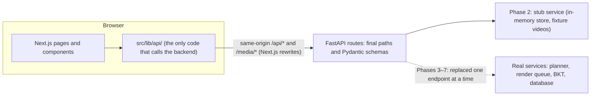
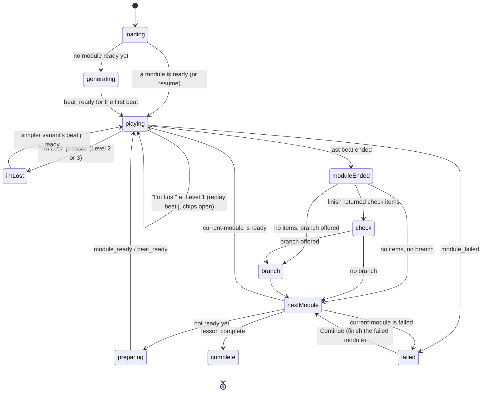

# Phase 2: the complete frontend on a stub API

This is the working guide for Phase 2 of [the plan](PLAN.md). Read all of it before writing code.
It says what to build, how the pieces fit, and the rules that let us swap the stub data for the
real backend later **without changing the frontend**. Section numbers such as "§5.6.3" and figure
numbers such as "Fig. 4.3" refer to the project report.

> **Status: lane A's part is done.**
>
> - Every endpoint in §7 exists and is served by the stub (§8).
> - The example videos are committed.
> - `npm run api:types` generates the frontend's types, and CI checks they are up to date.
> - Next.js forwards `/api` and `/media` to the backend.
>
> Start the backend with `npm run dev` (or `npm run dev:backend`), log in with a test account from
> §8, and browse every endpoint at <http://localhost:8000/docs>.
>
> **Phase 3 added real lessons** (README, "Lessons through the queue").
>
> - **What they are:** lessons made with `POST /api/dev/render` are rendered by the real queue and
>   served from the database, through the same endpoints and shapes. Use them to test the player
>   against real rendering times.
> - **Telling them apart:** the stub's lessons and modules now have ids from 1,000,000; real ones
>   from 1. Nothing in the frontend may depend on id values.
> - **What they can't do yet:** "I'm Lost" and branch choices return 409 until Phase 6, and their
>   `finish` returns no branch.
> - **Partial manifests:** for real lessons the manifest really is partial while beats render, so
>   §6.2's partial-manifest handling can now be tested.

---

## 1. The goal in one paragraph

By the end of Phase 2, every screen the report describes works in the browser:

- the landing page, register, login and logout
- the onboarding diagnostic
- the home screen with the topic query
- the lesson player, with captions, concept chips, "I'm Lost", rewind and speed
- the check questions and branch choices between modules
- resuming a lesson, lesson history and the progress screen
- the whole admin area

The backend behind it is a **stub**. Every endpoint exists at its final path with its final
request and response shapes, but the data comes from an in-memory store and a few real
pre-rendered videos instead of the LLM pipeline, the render queue and the learner model. In
Phases 3–7 the stub inside each endpoint is replaced by the real code. The paths and shapes stay
the same, so the frontend keeps working untouched.



---

## 2. The rules (read these twice)

These rules are what make "just swap the backend later" true. Breaking one of them is how we
end up with integration bugs in Phase 5.

1. **The frontend never decides what the backend owns.** It shows what the API says. It never
   works out the level of a module, whether an answer is correct, which module comes next, a
   confidence score, or whether a query is in scope. If a screen needs a value, the API returns
   it.
2. **All backend calls go through `src/lib/api/`.** No `fetch` anywhere else. Components use the
   hooks in `src/lib/api/hooks/`.
3. **API types are generated, never hand-written.** The backend's Pydantic models are the source
   of truth. `npm run api:types` turns them into `src/lib/api/schema.d.ts`. If you need a field
   that doesn't exist, ask lane A to add it to the backend schema, then regenerate. Never add
   "temporary" fields or fake data on the frontend side.
4. **Mock data lives only in the backend stub** (`backend/app/stub/`). The frontend has no mock
   mode. (Unit tests may use small hand-made objects.)
5. **Every screen handles four states:** loading, error (with a retry), empty, and success.
6. **The player takes every time from the manifest.** Beat durations, step times, captions and chip
   intervals all come from `ModuleManifest`. Nothing is hard-coded.
7. **Event positions are beat-local.** `position_s` is seconds from the start of the current beat's
   video, not of the module (docs/contracts.md).
8. **The session lives in an HttpOnly cookie only.** Nothing about the user goes into
   `localStorage`.
9. **No new npm dependency without agreement.** The approved list is in §9.
10. **A change to an API shape is a contract change.** It needs a PR that all three review, as
    for the contracts in `backend/app/contracts/`.

---

## 3. Who does what

Lanes are defined in [PLAN.md §2](PLAN.md#2-team-lanes). For Phase 2:

| Lane                  | Phase 2 work                                                                                                                                                                                                                                                                    |
| --------------------- | ------------------------------------------------------------------------------------------------------------------------------------------------------------------------------------------------------------------------------------------------------------------------------- |
| **C — Player**        | Everything under `/lessons/[lessonId]`: the player, captions, chips and chip overlay, "I'm Lost", the generating and preparing screens, checks, branches, the lesson summary, resume, the event logger, the SSE hook                                                            |
| **B — App and admin** | Design system and layout, landing page, topics page, register, login and logout, route guards, diagnostic, home, lesson history, progress, account, and all admin pages                                                                                                         |
| **A — API and stub**  | Week 5 (and into 6): every endpoint in §7 as a FastAPI route with Pydantic schemas, the stub service of §8, the fixture videos, `npm run api:types`, the Next.js rewrites. Then A moves on to Phase 3 (job queue), answering API questions and fixing stub bugs as they come up |

Both frontend people review each other's PRs. Lane A reviews any PR that touches `backend/` or
the generated API types.

B and C don't wait for the stub to start. In the first days, B builds the design system and the
static landing page, and C rebuilds the player against the manifest endpoint that already exists
(`GET /api/variants/{cache_key}/manifest`).

---

## 4. How the frontend talks to the backend

### Same origin through Next.js rewrites

The browser talks only to the Next.js server, at `http://localhost:3000`. `next.config.ts`
rewrites `/api/:path*` and `/media/:path*` to the backend (`BACKEND_URL`, default
`http://localhost:8000`; in Docker `http://backend:8000`). This means:

- the session cookie just works, with no CORS and no third-party cookie problems
- `navigator.sendBeacon` works for the last events and the playback position when a tab closes
- the study deployment over HTTPS (Phase 7) is also one origin, so dev and deployment behave the
  same

`NEXT_PUBLIC_API_URL` is gone. The API client uses relative URLs (`/api/...`), and media URLs
come from the manifest as `/media/variants/<cache_key>/<path>`. `npm run dev` passes the right
`BACKEND_URL` to the frontend; Docker Compose sets it to `http://backend:8000`.

> **Checked:** in `next dev`, Server-Sent Events arrive through the rewrite one by one, at the
> moment the backend sends them, not in a burst at the end. Video files support range requests
> (`206 Partial Content`), so seeking works. The backend sends
> `Cache-Control: no-cache, no-transform` and `X-Accel-Buffering: no` on the stream. Check the
> stream again when the study deployment is set up (Phase 7), because a production server or
> proxy can buffer it.

### The API client

```
frontend/src/lib/api/
  openapi.json     generated: the backend's OpenAPI document (committed)
  schema.d.ts      generated: TypeScript types from it (committed)
  client.ts        one openapi-fetch client: relative base URL, credentials "include",
                   401 → redirect to /login?next=…, errors turned into ApiError
  hooks/           TanStack Query hooks, one file per area: auth.ts, lessons.ts, player.ts, …
  sse.ts           useLessonStream(lessonId, handlers)
  beacon.ts        sendBeacon helpers for pagehide
```

`openapi.json` and `schema.d.ts` exist already. The rest of the folder (`client.ts`, `hooks/`,
`sse.ts`, `beacon.ts`) is the frontend team's to write. `npm run api:types` (root script):

1. writes `app.openapi()` to `frontend/src/lib/api/openapi.json` **without starting the server**
2. runs `openapi-typescript` on it to produce `schema.d.ts`

CI runs the same command and fails if either file changes. So the backend schema and the frontend
types can never drift apart.

`src/lib/contracts.ts` (the hand-written mirror from Phase 1) is deleted once the generated types
cover the manifest.

### Errors

- FastAPI sends `{"detail": "message"}` for errors and a list of field errors for 422. `client.ts`
  turns both into one `ApiError { status, message, fieldErrors }`.
- **401:** redirect to `/login?next=<current path>`.
- **403 on an admin page:** show "You don't have access to this page."
- **Network failure:** show a retry. While `navigator.onLine` is false, show an "You're offline"
  banner.
- Never show a raw error object or stack trace to a student.

---

## 5. Screens

Every screen has its route, its report source, what it shows, its API calls, and its acceptance
criteria. The header on every page follows the wireframes: **"~ FourierLearn"** on the left, and
**How it works**, **Adapts to you** and **Try a lesson** on the right (Fig. 4.1–4.6). When the user
is logged in, the header also shows Home, Progress and an account menu (Account, Log out). Admins
also get Admin.

### Route map

```
src/app/
  page.tsx                          /                       landing (public)
  topics/page.tsx                   /topics                 supported topics (public)
  (auth)/login/page.tsx             /login
  (auth)/register/page.tsx          /register
  (student)/layout.tsx              guard: logged in; diagnostic done (except /diagnostic)
  (student)/diagnostic/page.tsx     /diagnostic             Fig. 4.1
  (student)/home/page.tsx           /home                   Fig. 4.2
  (student)/lessons/page.tsx        /lessons                lesson history
  (student)/lessons/[lessonId]/page.tsx   lesson player     Fig. 4.3, 4.4, 4.5
  (student)/progress/page.tsx       /progress               Fig. 4.6
  (student)/account/page.tsx        /account
  admin/layout.tsx                  guard: role admin; sidebar
  admin/page.tsx                    /admin                  overview
  admin/primitives/page.tsx         /admin/primitives
  admin/glossary/page.tsx           /admin/glossary
  admin/check-questions/page.tsx    /admin/check-questions
  admin/render-jobs/page.tsx        /admin/render-jobs (+ [jobId])
  admin/students/page.tsx           /admin/students (+ [studentId])
  dev/modules/page.tsx              /dev/modules            Phase 1 developer viewer (keep)
  not-found.tsx, error.tsx
```

The guards are client components that read `useMe()` (`GET /api/auth/me`). The backend enforces
the same rules, so a guard is for a good experience, not for security.

### 5.1 Landing page `/` (lane B)

Not a wireframe in the report, but its header links point here. It reuses Fig. 4.2's headline.

- **Hero:** "Maths you can see." and the sentence from Fig. 4.2. Button **Try a lesson**: goes to
  `/register` when logged out, `/home` when logged in. Also a **Log in** link.
- **`#how-it-works`:** three steps. Ask a question in your own words; watch short narrated,
  animated modules; answer a quick check and choose where to go next.
- **`#adapts-to-you`:**
  - three difficulty levels (Table 5.3, in student language)
  - the **I'm Lost** button, which replays the part you're stuck on, explained more simply
  - concept chips
  - a confidence profile that updates as you learn
- **Topics:** the topic areas from `GET /api/topics`, linking to `/topics`.
- **Demo:** one fixture module's video with its controls, which plays only when clicked.
- **Footer:** project name, FAST-NUCES Lahore, Final Year Project, team and supervisor.
- **Honest content only:** no invented statistics, testimonials or school logos.

**Done when** it works at 375 px, 768 px and 1280 px widths, the header anchors scroll to their
sections, and Lighthouse accessibility scores at least 90.

### 5.2 Register, login, logout (lane B; UC 4.1)

- **Register:**
  - fields: name (1–100 characters), email, password (at least 8 characters) and confirm password
  - an email already in use gets 409, shown as "An account with this email already exists."
- **Login:**
  - fields: email and password
  - a 401 shows **"Incorrect email or password."** (UC 4.1, alternative flow)
  - a disabled account gets 403, shown as "This account has been disabled."
- **After register or login:**
  - follow `?next=` if present
  - otherwise admins go to `/admin`, students with `diagnostic_complete: false` go to
    `/diagnostic`, and everyone else goes to `/home`
- **Logout** (account menu): `POST /api/auth/logout`, clear the TanStack Query cache, then go to
  `/`.
- Visiting `/login` while logged in redirects to where you would land after login.

### 5.3 Onboarding diagnostic `/diagnostic` (lane B; Fig. 4.1, UC 4.2)

- Shows **"Question n of N"**, then the question and its options as large buttons. Selecting an
  option highlights it, and **Next** submits it (as in the wireframe). True/false items show two
  buttons.
- N is at most 5 and comes from the API.
- **No feedback on correctness.** The diagnostic measures; it doesn't teach.
- **Resumable:** `GET /api/diagnostic` returns the next unanswered item, so leaving and logging in
  again continues where the student stopped (UC 4.2, alternative flow).
- On the last answer the API returns `complete: true`. Go to `/home` with the toast "You're all
  set."
- Until the diagnostic is complete, every other student page redirects here.

### 5.4 Home `/home` (lane B; Fig. 4.2, UC 4.3)

- **The query box:**
  - headline, then the query box with **Generate lesson**, as in the wireframe
  - a student can start a lesson in **two steps**: type, then press (§4.4.2)
  - the query is required and at most 300 characters
  - the button is disabled while sending
- **Example queries:** three suggested queries under the box. Clicking one fills the box; it
  doesn't submit.
- **Submitting:** `POST /api/lessons`.
  - `status: "created"`: go to `/lessons/{lesson_id}`.
  - `status: "out_of_scope"`: show the message and the nearest concepts as buttons (each fills
    the box with "Explain <concept>"), and link to the topic list (UC 4.3, alternative flow).
- **Recent lessons:** the last five from `GET /api/lessons`, in the wireframe's
  "title | n modules | resume" format.
  - an in-progress lesson shows **Resume**
  - a completed lesson shows "Completed"
  - **See all** goes to `/lessons`

### 5.5 Lesson player `/lessons/[lessonId]` (lane C; Fig. 4.3–4.5)

The biggest piece of work. It has its own section, §6.

### 5.6 Progress `/progress` (lane B; Fig. 4.6)

- Title **"Per-concept confidence"**. One bar per **topic area** with a percentage, as in the
  wireframe.
  - The bar shows the mean of the area's concept scores; the frontend works out this mean only
    for display.
  - Expanding a topic area shows each concept's bar and name.
- Caption under the bars: "Confidence is estimated from your diagnostic, viewing behaviour, and
  quick checks."
- Source: `GET /api/progress`.

### 5.7 Lesson history `/lessons` (lane B; §4.2.1)

- All lessons, newest first: title, date, status (in progress, completed or abandoned), and
  modules completed out of the total.
- An in-progress lesson has **Resume**, which opens the player at the saved position.
- Empty state: "No lessons yet", with a link to `/home`.

### 5.8 Account `/account` (lane B)

Name, email, the date the account was created, and **Log out**.

### 5.9 Topics `/topics` (lane B, public)

Topic areas and their concepts with syllabus codes, from `GET /api/topics`. The out-of-scope reply
links here.

### 5.10 Admin `/admin/*` (lane B; §4.2.2)

The admin area has a sidebar layout. Tables are paginated (20 per page) with search where noted.
Every destructive action asks for confirmation. Math in text fields is previewed with KaTeX
(§9).

| Page            | What it does                                                                                                                                                                                                                                                                                                                                      |
| --------------- | ------------------------------------------------------------------------------------------------------------------------------------------------------------------------------------------------------------------------------------------------------------------------------------------------------------------------------------------------- |
| Overview        | Counts from `GET /api/admin/summary`: students, lessons today, failed renders in the last 24 h, render success rate over 7 days                                                                                                                                                                                                                   |
| Primitives      | Table of id, topic, version, status, description. **Enable/retire** toggle and an editable description. A note on the page says that new primitive code arrives through a pull request and must pass the validation harness, so admins can't upload code here ([PLAN §13](PLAN.md#13-gaps-and-contradictions-in-the-report-to-settle-now), gap 5) |
| Glossary        | Create, edit, delete. Fields: concept (select), term (at most 60 characters, shown as a chip), definition (text, may contain `$…$` math). Search by term, filter by concept                                                                                                                                                                       |
| Check questions | Create, edit, delete. Fields: concept, type (multiple choice or true/false), question text, options (2–4 for multiple choice; fixed "True"/"False" for true/false), and the correct option, which must be one of the options. Filter by concept                                                                                                   |
| Render jobs     | Filter by status. Columns: id, lesson, module, level, priority, status, attempts, duration, created. A failed job opens its error and log                                                                                                                                                                                                         |
| Students        | Search by name or email. Columns: name, email, joined, last active, lessons, diagnostic done, status. Detail page. **Disable/enable** and **delete** (delete asks the admin to type the email to confirm)                                                                                                                                         |

### 5.11 Errors, loading and not found (both)

- `not-found.tsx`: a friendly 404 with a link home.
- `error.tsx`: "Something went wrong" with **Try again**.
- Skeletons while lists load, and a spinner on buttons that are sending.
- Toasts for success messages, and inline messages for form errors.

---

## 6. The lesson player (lane C)

Read §5.4.4, §5.5 and §5.6 of the report, and `docs/contracts.md` (the manifest, the events and
the stream), before starting. The Phase 1 developer viewer
(`frontend/src/app/dev/modules/page.tsx`) already plays a variant beat by beat. Use it as a
starting point, but rebuild it as a feature module:

```
src/features/player/
  LessonPlayer.tsx       the page's top component: runs the lesson state machine
  lessonMachine.ts       the state machine of §6.1 (a reducer, unit-tested)
  VideoStage.tsx         two <video> elements that take turns (§6.3)
  useTimeline.ts         beat ↔ module time maths (§6.4), unit-tested
  Controls.tsx           play/pause, rewind, segmented progress bar, time, speed, captions, fullscreen
  Captions.tsx  ChipBar.tsx  ChipOverlay.tsx
  ImLostButton.tsx  ImLostOverlay.tsx
  GeneratingScreen.tsx  PreparingNext.tsx
  CheckPanel.tsx  BranchPanel.tsx  LessonSummary.tsx  ModuleFailed.tsx
  eventLogger.ts         batching and rules of §6.10, unit-tested
  usePositionSaver.ts    §6.9
```

### 6.1 The lesson state machine



`lessonMachine.ts` is a plain reducer. Components dispatch events to it, and the effects
(API calls, video commands) run in hooks. This keeps the flow testable without a browser.

### 6.2 Starting and loading a module

1. **Load the lesson.** Call `GET /api/lessons/{id}`. If it has a `position`, this is a **resume**:
   load that module, seek to the beat and position, and show a large **Resume** button. Browsers
   block autoplay with sound after a page reload.
2. **Find the module to play.** Call `GET /api/lessons/{id}/current-module`:
   - `ready`: fetch `GET /api/variants/{cache_key}/manifest` and play from beat 0 (or the resume
     point).
   - `preparing`, for the first module: show **GeneratingScreen**. It shows "Preparing your
     lesson…", the stage (planning → parameters → narration → rendering), and the seconds
     elapsed. The report's target is at most 90 s (§4.4.1). The response's `stage` gives the
     stage when the page opens; `generation_progress` events update it after that.
   - `failed`: see "A failed module" in §6.8.
   - `complete`: show **LessonSummary**.
3. **A manifest may be partial.** Playback starts when beat 0 is ready, and an "I'm Lost" variant
   may begin at beat _j_.
   - On every `beat_ready` for the playing `cache_key`, fetch the manifest again.
   - If playback reaches a beat that isn't in the manifest yet, pause and show a small "Preparing…"
     spinner over the video until it arrives. Don't count this pause as a student pause.

### 6.3 Two videos that take turns

- **Two `<video>` elements, A and B, are both always mounted.** The active one is visible and the
  other is hidden with `opacity: 0` and `pointer-events: none`. Don't use `display: none`, so it
  keeps loading.
- **Preload only the next beat.** While beat _i_ plays, the hidden element loads beat _i + 1_
  (`preload="auto"`). Load no further ahead (§6.4.7, memory on the student's device).
- **Swap on `ended`.** Call `play()` on the hidden element first, then swap visibility, so there
  is no black frame between beats.
- **Apply the playback rate to both elements**, so it carries over between beats and modules.
- **Set `playsInline` and `controls={false}`.** We draw our own controls.
- When a beat is no longer needed, clear its element's `src` and call `load()`, to free memory.

### 6.4 Time and the progress bar

- **Module time:**
  - module duration = sum of `beats[].duration_s`
  - module position = sum of the durations of the earlier beats + `currentTime` of the active
    video
  - write `useTimeline.ts` to convert between (beat index, beat time) and module time, and
    unit-test it
- **Time display:** `m:ss / m:ss`, as in the wireframe ("0:20 / 1:00").
- **Segmented progress bar:** one segment per beat, with widths proportional to duration, as in
  Fig. 4.3.
  - Clicking or dragging seeks anywhere. Seeking into another beat loads that beat into the active
    element.
  - Use `role="slider"` with `aria-valuetext` ("0:20 of 1:00").
  - ← and → move 5 s; Home and End go to the start and end.
- **Missing beats:** segments for beats not yet in the manifest are striped and can't be seeked
  into.

### 6.5 Controls (Fig. 4.3)

| Control       | Behaviour                                                                                                                                                  |
| ------------- | ---------------------------------------------------------------------------------------------------------------------------------------------------------- |
| Play/pause    | Button, Space or K                                                                                                                                         |
| Rewind ↺      | Back 10 s, across beat boundaries if needed (not before 0:00). Also J or ←                                                                                 |
| Speed         | Menu: 0.5×, 0.75×, 1×, 1.25×, 1.5×, 2× (the contract allows 0.25–4). The button shows the rate ("1x"). Kept for the whole lesson                           |
| Captions      | The narration of the current step (`steps[]` of the current beat), under the video as in the wireframe. CC button or C toggles them; on by default         |
| Volume / mute | Button, M to mute                                                                                                                                          |
| Fullscreen    | Makes the **whole player container** fullscreen, not the `<video>`, so that captions, chips and "I'm Lost" stay visible (§4.4.2). F                        |
| Module header | "Module n", the module title, the **level badge** ("Level 2") and the next-module status: "Preparing next module…" or "Next module ready", from the stream |

Keyboard shortcuts must not fire while focus is in a text field, and must not scroll the page.

### 6.6 Concept chips (§5.6.2, UC 4.5)

- **ChipBar** (under the captions) shows the chips whose `[start_s, end_s]` contains the current
  time of the current beat.
- **Prefetch definitions.** When a chip first appears, fetch its definition with
  `GET /api/glossary/{term}` and cache it, so it opens instantly (≤ 3 s, §4.4.1).
- **Opening a chip** shows **ChipOverlay**, a non-modal popover with the term and its definition
  (math rendered with KaTeX). **The video keeps playing.** Don't pause it. Close with ×, Esc or a
  click outside.
- **Log** a `chip_view` event when a chip opens (§6.10).

### 6.7 "I'm Lost" (§5.6.3, UC 4.4)

- **The button** is always visible during playback: while paused, in fullscreen, and on a tablet
  in portrait. It works with **one tap** (§4.4.2) or the L key. It is disabled only while a
  substitution is already in progress.
- **On press:**
  1. Pause.
  2. Call `POST /api/lessons/{id}/im-lost` with `{module_id, beat_index, position_s}`.
  3. Do **not** send an `im_lost` event from the logger; the endpoint records it.
- **`action: "substitute"`** (the module was at Level 2 or 3):
  - Show **ImLostOverlay**: "Making a simpler version…", with a progress indicator and the seconds
    elapsed (§4.4.1, at most 90 s).
  - The simpler variant is ready when either `ready: true` comes back, or a `beat_ready` arrives
    with that `cache_key` and `beat_index == resume_beat_index`. Then fetch its manifest, switch
    to it, set the level badge to the new level, and play from **the start of beat _j_**. The
    rest of the module plays at the lower level.
  - After 90 s, show "This is taking longer than usual" with **Keep watching at this level**,
    which resumes the old variant where it paused. Keep listening: if the simpler version
    arrives later, offer **Switch to the simpler version**.
- **`action: "replay"`** (the module was already at Level 1):
  - Seek to the start of beat _j_ in the same variant and play.
  - Open the chip definitions of beat _j_ in an expanded panel beside the video.
  - If `worked_example_added` is true, show the toast "We'll add a worked example after this
    module."

### 6.8 Between modules: check, branch, next

When the last beat ends:

1. **Finish the module.** Flush the event logger, then call
   `POST /api/lessons/{id}/modules/{module_id}/finish`. It returns `check_items` (0–2) and
   `branch` (or null).
2. **Check** (Fig. 4.4, §5.7.3, UC 4.6):
   - Title **"Quick check before we continue"**. One item at a time.
   - True/false items show **True** and **False** buttons, as in the wireframe. Multiple choice
     shows up to four option buttons.
   - **One tap answers.** Call `POST /api/check-responses`. Show for about 1.5 s whether the answer
     was right and what the correct answer is, then move on. A **Continue** button lets the student
     skip the wait.
   - **The check never blocks progress.** A wrong answer still continues. If the request fails,
     retry it in the background up to 3 times and move on anyway.
   - Footnote from the wireframe: "Your answer updates your confidence profile and the difficulty
     of upcoming modules."
3. **Branch** (Fig. 4.5, §5.6.4, UC 4.7):
   - Title **"Where should the lesson go next?"**. One card per option, with its title and
     description, as in the wireframe.
   - A thin countdown bar shows `timeout_s`. When it runs out, the default is chosen.
   - Call `POST /api/lessons/{id}/branch` with `{module_id, choice, timed_out}`. Don't send a
     `branch_choice` event from the logger; the endpoint records it.
4. **Next module.** Call `GET /api/lessons/{id}/current-module`:
   - `ready`: play it.
   - `preparing`: show **PreparingNext** ("Preparing the next module…") until a `module_ready` or
     the first `beat_ready` for it arrives, then call `current-module` again.
   - `failed`: see "A failed module" below.
   - `complete`: show **LessonSummary**.
5. **Lesson summary:**
   - the modules watched
   - the concepts taught, with their confidence from `GET /api/progress`
   - buttons for **Home**, **See progress** and **New lesson**

**A failed module** (§6.4.6). The stream sends `module_failed`, and `current-module` then returns
`status: "failed"` with a `failure`. Read it from `current-module`, so a page reload shows it too.

- If `failure.fallback` is `"cached_variant"`, the server has a replacement, and `current-module`
  returns it as `ready` instead.
- If it is `"glossary_definition"`, show a card with `failure.message`, the concept's definition
  (`failure.definition`, with KaTeX) and **Continue**.
- With no fallback, show `failure.message` and **Continue**.

**Continue** calls `finish` for the failed module. This returns no checks and no branch, and the
lesson moves on to the next module.

### 6.9 Saving the position and resuming (§4.4.3)

- **When to save:** `POST /api/lessons/{id}/position` with `{module_id, beat_index, position_s}`:
  - every 10 s while playing
  - on pause
  - when a module ends
  - on `pagehide`, using `navigator.sendBeacon`, which works because we are same-origin
- **Where it's read:** `GET /api/lessons/{id}` returns the saved `position`, which §6.2 resumes
  from.

### 6.10 The event logger (§5.6.1, Table 4.8, Table 5.4)

The event shapes are the contracts in `backend/app/contracts/interaction.py`. Every event
carries:

- `module_id`
- `occurred_at`, an ISO time with a time zone (`new Date().toISOString()`)
- for playback events, `beat_index` and `position_s` (beat-local)

| Event           | Send when                                                                                                                                                   | Extra fields                     |
| --------------- | ----------------------------------------------------------------------------------------------------------------------------------------------------------- | -------------------------------- |
| `rewind`        | The **student** seeks backwards: the ↺ button, J or ←, or a click/drag on the bar to an earlier point. One event per action; a drag counts once, on release | `to_beat_index`, `to_position_s` |
| `speed_change`  | The student picks a different rate                                                                                                                          | `from_rate`, `to_rate`           |
| `pause`         | The student paused. Send it **when playback resumes**, with how long it lasted. If the page closes while paused, send it on `pagehide` with the time so far | `duration_s`                     |
| `chip_view`     | A chip overlay opens                                                                                                                                        | `term`                           |
| `im_lost`       | **Never from the logger.** The im-lost endpoint records it                                                                                                  |                                  |
| `branch_choice` | **Never from the logger.** The branch endpoint records it                                                                                                   |                                  |

**Not logged:**

- seeks the player makes itself (resume, the "I'm Lost" jump, the Level 1 replay)
- pauses the player makes itself (the end of a module, waiting for a beat, the "I'm Lost" wait,
  the tab being hidden)
- seeking forwards

**Batching:**

- **What:** events go into a buffer, sent as `POST /api/events` with
  `{"events": [...]}` (1–100 events).
- **When:**
  - every 10 s
  - when 20 events are waiting
  - when a module ends (before `finish`)
  - on `pagehide`, using `sendBeacon`
- **On failure:** keep the events and retry with the next flush. Drop the oldest events beyond 500
  so memory stays bounded.

### 6.11 The event stream (§6.4.12)

`useLessonStream(lessonId, handlers)` in `src/lib/api/sse.ts`:

- Opens one `EventSource('/api/lessons/{id}/events')` per lesson page, and closes it on unmount.
- The SSE event name is the `type` of the stream contract (`generation_progress`, `beat_ready`,
  `module_ready`, `module_failed`). The data is its JSON.
- **The stream only sends events that happen after it opens.** So on **every** `onopen`, the first
  and each reconnect after an `onerror`, refetch `GET /api/lessons/{id}` and `current-module`
  before relying on new events (§6.4.12). This also covers events missed between creating the
  lesson and opening the page.

### 6.12 Static study mode (§5.9.4)

`GET /api/lessons/{id}` returns `mode: "adaptive"` or `"static"`. In static mode the player shows
only the ordinary controls: no chips, no "I'm Lost", no checks and no branches. The modules play
one after another. Build it now; it costs little. The stub has one static lesson to test with.

---

## 7. API catalogue

These are the final paths and shapes. Lane A writes them as Pydantic models (request and response
schemas in `backend/app/api/schemas/`, routes in `backend/app/api/routes/`). Those models are the
real definition, and `schema.d.ts` is generated from them. If this table and the code disagree,
fix whichever is wrong in the same PR.

**Conventions:**

- JSON everywhere. Ids are positive integers. Times are ISO 8601 with a time zone.
- Admin lists take `?page=&page_size=` (default 20, max 100) and return
  `{items, total, page, page_size}`.
- Without a session, every endpoint except `/api/health`, `/api/topics`, register and login
  returns **401**. Admin endpoints return **403** to students.
- The session is an HttpOnly cookie `fl_session` with `SameSite=Lax` (and `Secure` over HTTPS).

**Shared shapes** (written in a TypeScript-like notation for brevity):

```ts
User          = { id, name, email, role: "student" | "admin", diagnostic_complete: boolean, created_at }
Concept       = { id, name, syllabus_code, topic_area }
TopicArea     = { topic_area: string, concepts: Concept[] }
CheckItem     = { id, concept_id, item_type: "mcq" | "true_false", question_text, options: string[] }   // never the answer
Position      = { module_id, beat_index, position_s }
ModuleSummary = { id, sequence_no, title, concept_id, style: "default" | "theory" | "worked_example",
                  is_review: boolean, render_status: "queued" | "rendering" | "ready" | "failed",
                  level: 1 | 2 | 3 | null, completed: boolean }
Lesson        = { id, title, query_text, status: "in_progress" | "completed" | "abandoned",
                  mode: "adaptive" | "static", started_at, modules: ModuleSummary[], position: Position | null }
LessonSummary = { id, title, query_text, status, started_at, modules_total, modules_completed }
BranchPoint   = { options: { choice: "theory" | "worked_example" | "next_step", title, description }[],
                  default_choice: "next_step", timeout_s: number }
```

Text that can contain math (questions, options, definitions) marks inline LaTeX with `$…$`, for
example `What is the gradient of $y = 2x + 3$?`. The frontend renders it with KaTeX.

### Auth and account (UC 4.1)

| Method and path           | Request                   | Response                                                                        |
| ------------------------- | ------------------------- | ------------------------------------------------------------------------------- |
| `POST /api/auth/register` | `{name, email, password}` | 201 `User`, sets the cookie. 409 if the email is taken                          |
| `POST /api/auth/login`    | `{email, password}`       | 200 `User`, sets the cookie. 401 "Incorrect email or password." 403 if disabled |
| `POST /api/auth/logout`   | —                         | 204, clears the cookie                                                          |
| `GET /api/auth/me`        | —                         | 200 `User`, or 401                                                              |

### Topics and glossary

| Method and path            | Response                                                        |
| -------------------------- | --------------------------------------------------------------- |
| `GET /api/topics` (public) | `TopicArea[]`                                                   |
| `GET /api/glossary/{term}` | `{term, definition, concept_id}`, or 404. `term` is URL-encoded |

### Diagnostic (UC 4.2, §5.7.2)

| Method and path                | Request                       | Response                                                           |
| ------------------------------ | ----------------------------- | ------------------------------------------------------------------ |
| `GET /api/diagnostic`          | —                             | `{complete, total, answered, item: CheckItem \| null}` (total ≤ 5) |
| `POST /api/diagnostic/answers` | `{check_id, selected_option}` | The same shape, for the next item. No correctness is returned      |

### Lessons (UC 4.3) and playback

| Method and path                                     | Request                                  | Response                                                                                                                                                                                                                                                                                                                                                        |
| --------------------------------------------------- | ---------------------------------------- | --------------------------------------------------------------------------------------------------------------------------------------------------------------------------------------------------------------------------------------------------------------------------------------------------------------------------------------------------------------- |
| `POST /api/lessons`                                 | `{query_text}` (1–300 characters)        | 200, either `{status: "created", lesson_id}` or `{status: "out_of_scope", message, nearest_concepts: Concept[], topics: TopicArea[]}`                                                                                                                                                                                                                           |
| `GET /api/lessons`                                  | —                                        | `LessonSummary[]`, newest first                                                                                                                                                                                                                                                                                                                                 |
| `GET /api/lessons/{id}`                             | —                                        | `Lesson`                                                                                                                                                                                                                                                                                                                                                        |
| `GET /api/lessons/{id}/current-module`              | —                                        | `{status: "ready" \| "preparing" \| "failed" \| "complete", module: ModuleSummary \| null, level: 1\|2\|3 \| null, cache_key: string \| null, stage, failure}`. `ready` means at least the first beat can be played. `stage` (planning, parameters, narration, rendering) is set while `preparing`; `failure` (`{fallback, message, definition}`) when `failed` |
| `GET /api/lessons/{id}/events`                      | —                                        | `text/event-stream` of the stream contracts (`backend/app/contracts/stream.py`). A `: keep-alive` comment every 15 s                                                                                                                                                                                                                                            |
| `POST /api/lessons/{id}/position`                   | `Position`                               | 204. POST so that `sendBeacon` can call it                                                                                                                                                                                                                                                                                                                      |
| `POST /api/lessons/{id}/modules/{module_id}/finish` | —                                        | `{check_items: CheckItem[] (0–2), branch: BranchPoint \| null}`. The server applies the module's learning transition (Eq. 5.3) here                                                                                                                                                                                                                             |
| `POST /api/check-responses`                         | `{module_id, check_id, selected_option}` | `{is_correct, correct_option}`                                                                                                                                                                                                                                                                                                                                  |
| `POST /api/lessons/{id}/branch`                     | `{module_id, choice, timed_out}`         | `Lesson` (with the inserted module, if any). Records the `branch_choice` event                                                                                                                                                                                                                                                                                  |
| `POST /api/lessons/{id}/im-lost`                    | `{module_id, beat_index, position_s}`    | Either `{action: "substitute", level, cache_key, resume_beat_index, ready}` or `{action: "replay", resume_beat_index, worked_example_added}`. Records the `im_lost` event                                                                                                                                                                                       |
| `GET /api/variants/{cache_key}/manifest`            | —                                        | `ModuleManifest` (exists since Phase 1). Beat files are at `/media/variants/{cache_key}/{beat.video}`                                                                                                                                                                                                                                                           |
| `POST /api/events`                                  | `InteractionEventBatch`                  | 202. 422 for `im_lost` and `branch_choice` (their endpoints record them); 404 for a module that isn't in the student's lessons                                                                                                                                                                                                                                  |
| `GET /api/dev/events?limit=`                        | —                                        | Development only: the signed-in user's last events (`{student_id, received_at, event}`), oldest first                                                                                                                                                                                                                                                           |

### Progress

| Method and path     | Response                                                                               |
| ------------------- | -------------------------------------------------------------------------------------- |
| `GET /api/progress` | `{concepts: {concept_id, name, topic_area, syllabus_code, score (0–1), updated_at}[]}` |

### Admin (§4.2.2)

| Method and path                                                                             | Notes                                                                                                                                                |
| ------------------------------------------------------------------------------------------- | ---------------------------------------------------------------------------------------------------------------------------------------------------- |
| `GET /api/admin/summary`                                                                    | `{students, lessons_today, renders_failed_24h, render_success_rate_7d}`                                                                              |
| `GET /api/admin/primitives`, `PATCH /api/admin/primitives/{id}`                             | Items `{id, topic, version, status: "enabled" \| "retired", description}`. PATCH takes `status` and/or `description`                                 |
| `GET`, `POST /api/admin/glossary`; `PATCH`, `DELETE /api/admin/glossary/{term_id}`          | Items `{id, concept_id, term, definition}`. `?search=&concept_id=`                                                                                   |
| `GET`, `POST /api/admin/check-questions`; `PATCH`, `DELETE /api/admin/check-questions/{id}` | Items `{id, concept_id, item_type, question_text, options, correct_option}`. 422 if `correct_option` is not one of `options`. `?concept_id=`         |
| `GET /api/admin/render-jobs`, `GET /api/admin/render-jobs/{id}`                             | Items `{id, lesson_id, module_id, level, priority, status, attempts, created_at, finished_at, duration_s, error}`; the detail adds `log`. `?status=` |
| `GET /api/admin/students`, `GET`, `PATCH`, `DELETE /api/admin/students/{id}`                | Items `{id, name, email, created_at, last_active_at, lessons, diagnostic_complete, disabled}`. PATCH takes `disabled`. `?search=`                    |

Some of these need database columns that Table 4.8 doesn't have, such as `check_question.options`,
`item_type`, `student.role`, `student.disabled` and the `primitive` and `render_job` tables. They
are already listed in [PLAN §13](PLAN.md#13-gaps-and-contradictions-in-the-report-to-settle-now), gap 3. The stub doesn't need them, and the phase that
replaces each stub adds them with a migration.

---

## 8. The stub backend (lane A)

The stub runs with the normal `npm run dev` (or `npm run dev:backend`) and needs **no Postgres,
LaTeX, Manim or voice model**. That way the frontend team can run it on any laptop.

### Where it lives

- **`backend/app/stub/`**
  - `store.py`: the in-memory store and all the behaviour below. It resets when the server
    restarts.
  - `seed.py`: the seed data (topics, glossary, item bank, primitives, accounts).
  - `fixtures.py`: loads the fixture videos.
- **`backend/fixtures/variants/<cache_key>/`**: **committed** pre-rendered variants of the example
  module "gradient of a straight line".
  - Rendered at Level 1 (71 s), Level 2 (47 s) and Level 3 (19 s), at 480p30 with the Kokoro
    voice.
  - 6.7 MB together. Each has its `manifest.json`, the beat files and `module.mp4`.
  - On startup the stub copies any that are missing into `backend/media/variants/`.
- **`backend/app/api/schemas/`**: the request and response models.
- **`backend/app/api/routes/`**: each route calls the stub for now. `STUB_API=true` (the default
  during Phase 2) switches the stub on.
- Every stub response carries the header `X-FourierLearn-Stub: 1`, so nobody mistakes stub data for
  real data.
- `STUB_LATENCY_MS` (default 300) delays every stub response, so that loading states are visible
  and get tested.

### Seed data

Stub-only accounts, never used anywhere real:

| Email                       | Password      | State                                                                                        |
| --------------------------- | ------------- | -------------------------------------------------------------------------------------------- |
| `student@fourierlearn.test` | `password123` | Diagnostic done. One lesson in progress (at module 2), one completed, one static-mode lesson |
| `new@fourierlearn.test`     | `password123` | Diagnostic not started                                                                       |
| `admin@fourierlearn.test`   | `password123` | Admin                                                                                        |

Registration creates new students in memory, and they start with the diagnostic. The seed data
also includes:

- the five topic areas of Fig. 4.6, with a few concepts each and their syllabus codes
- glossary terms for every chip in the fixture manifests
- about 15 check items, some multiple choice and some true/false, with `$…$` math in a few
- primitives from the real library (`app/primitives/library.py`)
- a handful of render jobs, including failed ones with error text
- about 10 students

### Behaviour that must be realistic

- **`POST /api/lessons`.**
  - Recognised queries create a lesson of three modules that all use the fixture variants, with
    different titles and levels (module 1 at Level 2, module 2 at Level 3, module 3 at Level 2),
    so the level badge changes. Recognised means the query mentions gradient, slope, line or
    straight line.
  - Module 1 offers a branch (theory and worked example). Each module has one or two check items.
  - Any other query is `out_of_scope`, with two nearest concepts.
  - Test words in the query trigger special cases:
    - `test:slow`: the first module takes 60 s to prepare
    - `test:fail`: module 2 fails with the glossary fallback
    - `test:static`: a static-mode lesson
- **The first module's stream:** `generation_progress` planning, parameters, narration and
  rendering, 2 s apart. Then `beat_ready` for beats 0, 1 and 2, 1 s apart, then `module_ready`.
  When `current-module` first returns a module as ready, the stub starts preparing the next one,
  which is ready 8–10 s later. A module inserted by a branch is ready 6–8 s after the choice.
- **`im-lost` at Level 2 or 3:** returns `substitute` with the lower level's fixture `cache_key`
  and `ready: false`. About 5 s later, the stream sends `beat_ready` for `resume_beat_index`, then
  for the following beats. At Level 1 it returns `replay` with `worked_example_added: true`, and
  inserts a worked-example module into the lesson.
- **`branch`:** theory and worked example insert one module (using the fixture variants) after the
  current one; `next_step` inserts nothing.
- **`check-responses`:** answers come from the seed item bank. A wrong answer lowers that
  concept's stub score a little, and a right one raises it, so `/progress` visibly changes.
- **`events`:** validates with `InteractionEventBatch` and keeps the last 1000 events. A dev-only
  `GET /api/dev/events` lists them, so lane C can check the logger. `im_lost` and `branch_choice`
  sent here are refused with 422, so the mistake shows up straight away.
- **`position`:** stored per lesson and returned by `GET /api/lessons/{id}`.
- **Branch timeout:** 20 s.
- **Not simulated:** the stub's manifests are always complete, because every fixture beat exists
  on disk. The partial-manifest path of §6.2 still needs building. Test it with a unit test, and
  again against real renders in Phase 3.

---

## 9. Tools and dependencies

Already in the frontend: Next.js 16 (App Router), React 19 with the React Compiler lint rules,
TypeScript, Tailwind CSS 4, ESLint and Prettier.

Approved additions. Pin exact versions, which `.npmrc` already does:

| Package                                           | Why                                                        |
| ------------------------------------------------- | ---------------------------------------------------------- |
| `@tanstack/react-query`                           | Server data: caching, loading and error states, refetching |
| `openapi-fetch`                                   | A tiny client typed by `schema.d.ts`                       |
| `openapi-typescript` (dev)                        | Generates `schema.d.ts` from `openapi.json`                |
| `katex`                                           | Math in questions, options and definitions                 |
| `vitest`, `@testing-library/react`, `jsdom` (dev) | Unit and component tests                                   |
| `@playwright/test` (dev)                          | End-to-end tests of the main flows                         |

There's no UI kit. Small components of our own live in `src/components/ui/` (Button, Card, Dialog,
Popover, Toast, Spinner, Skeleton, Badge, ProgressBar, Table, Pagination, FormField, EmptyState,
ErrorState). Icons are inline SVG.

**Next.js 16 is newer than most tutorials.** Read `frontend/AGENTS.md` and the guides in
`frontend/node_modules/next/dist/docs/` before using an API you remember from older versions.

---

## 10. Design and accessibility

- **Look:** the wireframes are the layout. Keep it clean: white background, one accent colour, large
  readable maths, rounded buttons like the wireframes. Put colours, radii and spacing as tokens in
  `globals.css` so the whole app changes in one place.
- **Responsive (§4.4.2):** laptop and tablet first, and usable on a phone. Test at 375, 768 and
  1280 px wide, and on an iPad in portrait and landscape. On narrow screens the player controls
  wrap; "I'm Lost" never hides in an overflow menu.
- **Touch targets** are at least 44 × 44 px.
- **Keyboard:** everything works with the keyboard, focus is always visible, and dialogs trap
  focus and close with Esc.
- **Contrast:** at least WCAG AA.
- **Motion:** respect `prefers-reduced-motion` for interface animations (the lesson videos
  themselves are not affected).
- **Labels (§6.6.3):** chips, "I'm Lost" and branch options are clearly labelled. Loading and
  error messages say what is happening.

---

## 11. Testing

- **Unit tests (Vitest):**
  - `useTimeline` (beat ↔ module time, seeking across beats, partial manifests)
  - caption and chip lookup by time
  - `lessonMachine` (every transition in §6.1)
  - `eventLogger`: which actions log which event, batching and limits, and no `im_lost` or
    `branch_choice`
  - form validation
- **End-to-end tests (Playwright),** against `next dev` and the stub:
  1. register → diagnostic → home
  2. query → first module plays → open a chip → check → branch → next module → summary
  3. "I'm Lost" at Level 2 → plays at Level 1 from the same beat
  4. out-of-scope query
  5. leave mid-lesson → resume from the saved position
  6. admin creates, edits and deletes a glossary term
- **H.264 warning:** Playwright's bundled Chromium **cannot play H.264 MP4**, which is our video
  format. Run the e2e tests with `channel: "chrome"` (Google Chrome, which GitHub's runners have
  installed). Locally, use Chrome or Edge.
- **CI:** `npm run test` gains the Vitest run, and the `api:types` check runs in CI. A Playwright
  job is added in week 8.
- **Manual checks before calling a screen done:** Chrome, Firefox, and Safari on an iPad (or
  Safari on a Mac), at the three widths in §10.

---

## 12. Week by week

| Week | A — API and stub                                                                                                   | B — App and admin                                                                                  | C — Player                                                                                                  |
| ---- | ------------------------------------------------------------------------------------------------------------------ | -------------------------------------------------------------------------------------------------- | ----------------------------------------------------------------------------------------------------------- |
| 5    | Schemas and stubs: auth, topics, lessons, current-module, variants; fixtures; `api:types`; rewrites; the SSE check | Design tokens and `components/ui`; header, footer, layouts; landing page; login and register forms | Player feature module from the dev viewer: two videos, timeline, controls, captions, keyboard               |
| 6    | The rest of the stubs: diagnostic, finish, check, branch, im-lost, stream, events, position, progress, admin       | Auth wired to the API; guards; diagnostic; home (query, out-of-scope, recent); topics; account     | Chips and overlay; event logger; state machine; stream hook; generating screen                              |
| 7    | Phase 3 work; stub fixes                                                                                           | Progress; lesson history; admin: overview, primitives, glossary, check questions                   | Check panel; branch panel; "I'm Lost" (substitute and replay); preparing next; summary; position and resume |
| 8    | Phase 3 work; Playwright CI job                                                                                    | Admin: render jobs, students; responsive and accessibility pass; e2e tests                         | Static mode; failed modules; fullscreen; responsive and accessibility pass; e2e tests                       |

Integrate every week: small PRs merged into `main`, never one big merge at the end.

---

## 13. Done when (milestone M1)

- [ ] Every route in §5 exists and handles loading, error, empty and success.
- [ ] A new student can register, finish the diagnostic, ask a question and watch a lesson to the
      end, in Chrome, Firefox and iPad Safari, using only the UI.
- [ ] In the player: play, pause, rewind, seek across beats, speed, captions, chips (video keeps
      playing), fullscreen with "I'm Lost" visible, and keyboard shortcuts all work.
- [ ] "I'm Lost" at Level 2 resumes at Level 1 from the start of the same beat; at Level 1 it
      replays the beat with its chips open.
- [ ] Checks never block the lesson; branches time out to the default.
- [ ] Closing the tab mid-lesson and coming back resumes within a few seconds of where the student
      left.
- [ ] `GET /api/dev/events` shows the right events with beat-local positions, and no `im_lost`
      or `branch_choice` from the logger.
- [ ] All admin pages work: create, edit, delete, retire, disable.
- [ ] No `fetch` outside `src/lib/api/`; `npm run api:types` leaves no diff; `npm run test` is
      green; the e2e flows pass.
- [ ] Demo to the supervisor.

---

## 14. Common mistakes to avoid

- **Working out backend values in the browser.** Levels, correctness, scores, the next module: if
  you find yourself writing one, stop and ask lane A for an API field (rule 1).
- **Module-relative positions in events.** Positions are beat-local (rule 7).
- **Assuming a manifest is complete.** It may be partial (§6.2).
- **Pausing the video when a chip opens.** It must keep playing (UC 4.5).
- **Logging the player's own seeks and pauses as student signals.** They would corrupt the learner
  model (§6.10).
- **Opening the app at `127.0.0.1` instead of `localhost`.** Use `http://localhost:3000`, so that
  cookies and rewrites behave the same for everyone.
- **Autoplay.** `video.play()` returns a promise that browsers reject without a recent tap. Catch
  it and show the big Play button. Never assume playback started.
- **React Compiler lint errors** (reading refs during render, mutating values after render). Fix
  them properly; don't disable the rule. The Phase 1 viewer shows a working pattern: one ref
  holding both video elements, set through callback refs.
- **Hand-edited `schema.d.ts`.** It is generated; regenerate it instead.
